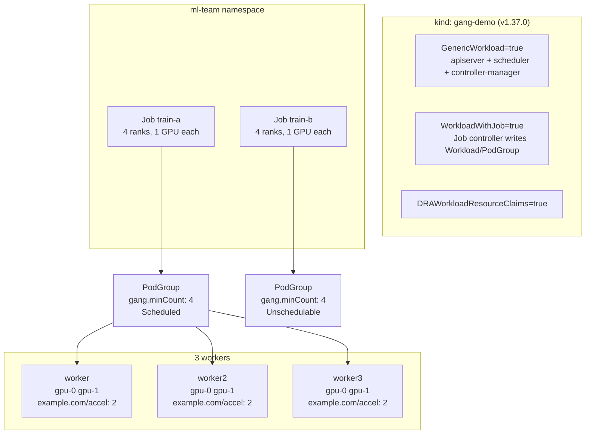

# Gang scheduling on Kubernetes 1.37: six fake GPUs, one deadlock, one field

[KEP-4671](https://github.com/kubernetes/enhancements/blob/master/keps/sig-scheduling/4671-gang-scheduling/README.md)
promoted the `Workload` and `PodGroup` APIs to **beta in Kubernetes v1.37**, which
finally puts all-or-nothing placement in `kube-scheduler` instead of in Volcano or
the coscheduling plugin.

This demo reproduces the problem it solves and then removes it, on a laptop, with
no GPU. Four Kind nodes, six fake DRA devices, two four-rank jobs. Demand eight,
supply six.

It also shows the two places the feature stops short in 1.37, both of which cost
more time to find than to fix.

## What makes it GPU-free

| Primitive | What it does here |
|---|---|
| [dra-example-driver](https://github.com/kubernetes-sigs/dra-example-driver) v0.5.0 | Publishes a `ResourceSlice` of `gpu.example.com` devices per node, so the **real DRA allocation path runs** against hardware that does not exist. Rendered from the upstream chart with `numDevices: 2` |
| `example.com/accel` on `node.status.capacity` | A plain node-local extended resource, patched onto each worker. Needed because workload-aware preemption cannot reclaim DRA devices yet, so the preemption acts use this instead |

The workload is `busybox` running `sleep`. Nothing trains. The whole demo is about
what the scheduler does before a container ever matters.

## Shape



Six devices, two gangs of four. Exactly one can run. Without a gang policy,
neither does.

## Prerequisites

- `kind` **v0.33.0+**, which is the first release shipping `kindest/node:v1.37.0`.
  The `Workload` API does not exist before 1.37
- `kubectl` v1.37+, `docker`, `task`, `python3`
- Docker with 8 GB is plenty. Four Kind nodes, no serving stack, no operators

## Run it

```bash
task up          # cluster + DRA driver + extended resource + namespace + priority classes
task deadlock    # two jobs, six GPUs, nothing trains
task gang        # the same jobs with gang.minCount: 4
```

Verify the API is actually served before anything else. If this comes back empty,
every later step fails quietly rather than erroring:

```bash
kubectl --context kind-gang-demo api-resources --api-group=scheduling.k8s.io
```

```
NAME              SHORTNAMES   APIVERSION                  NAMESPACED   KIND
podgroups                      scheduling.k8s.io/v1beta1   true         PodGroup
priorityclasses   pc           scheduling.k8s.io/v1        false        PriorityClass
workloads                      scheduling.k8s.io/v1beta1   true         Workload
```

## The three acts

### 1. Partial-placement deadlock

`task deadlock` applies two ordinary Jobs, no scheduling policy:

```
train-a-0   Running   gang-demo-worker
train-a-1   Running   gang-demo-worker2
train-a-2   Running   gang-demo-worker
train-a-3   Pending   <none>
train-b-0   Running   gang-demo-worker3
train-b-1   Running   gang-demo-worker3
train-b-2   Running   gang-demo-worker2
train-b-3   Pending   <none>
```

Six devices allocated, six containers running, neither job has four ranks. The
scheduler did nothing wrong: every pod that could be placed was placed.

The split is **not deterministic**. On other runs one job gets all four ranks and
the other wedges at two. Without gang semantics the outcome depends on pod arrival
order, which is the actual argument for the feature.

### 2. One field

`task gang` applies the same jobs with four lines added:

```yaml
spec:
  scheduling:
    schedulingPolicy:
      gang:
        minCount: 4
```

```
NAME                                         POLICY   STATUS
train-a-...-train-a-pgt-0-cc865b9db          Gang     Scheduled
train-b-...-train-b-pgt-0-fc65464f8          Gang     Unschedulable

   4 train-a   Running
   4 train-b   Pending
```

Four devices doing work, two free for the next job, and a `PodGroup` condition
that says why the second one waits.

### 3. Preemption, and where it stops

```bash
task dra-preempt   # a priority-10000 gang over DRA jobs: never preempts
task preempt       # the same over node-local resources: preempts pod by pod
task preempt:all   # with disruptionMode: all, evicts the gang as a unit
task metrics       # the three scheduler_podgroup_* metrics
```

## Gotchas

**`Job.spec.scheduling` is pruned silently without `WorkloadWithJob`.** This is the
one that costs an afternoon. `GenericWorkload` alone gets you the API but not the
Job field:

```bash
$ kubectl apply -f kubernetes/workloads/20-gang.yaml
job.batch/train-a created

$ kubectl -n ml-team get job train-a -o jsonpath='{.spec.scheduling}'
                              # empty. no warning, no event, no condition.
```

`WorkloadWithJob` ([KEP-5547](https://github.com/kubernetes/enhancements/issues/5547))
is **alpha and off by default** in 1.37, and it depends on `GenericWorkload`
(`pkg/features/kube_features.go:2308-2310` and `:2922` at `release-1.37`). The Job
runs with the old pod-by-pod behaviour and you go looking for a scheduler bug that
is not there.

**Every gate in this area is off by default**, including the beta ones:

| Gate | Stage in 1.37 | Default | Depends on |
|---|---|---|---|
| `GenericWorkload` | Beta | `false` | none |
| `WorkloadWithJob` | Alpha | `false` | `GenericWorkload` |
| `DRAWorkloadResourceClaims` | Beta | `false` | none |
| `CompositePodGroup` | Alpha | `false` | none |
| `PodGroupPreemptionPolicy` | Alpha | `false` | none |
| `TopologyAwareWorkloadScheduling` | Alpha | `false` | none |

**Workload-aware preemption does not reclaim DRA devices.** A priority-10000 gang
sitting on top of priority-100 DRA jobs stays `Unschedulable` forever, with no
`Preempted` events. That is expected in 1.37, per
[KEP-5710](https://github.com/kubernetes/enhancements/blob/master/keps/sig-scheduling/5710-workload-aware-preemption/README.md):

> Fixing global constraint tracking for nominations will be pursued as a separate
> enhancement, most likely before KEP-5690: DRA Workload Resource Claims starts
> supporting Workload-Aware Preemption (since DRA resources are often not
> node-local).

`task preempt` runs the same scenario over `example.com/accel` to show preemption
itself works. The limit is DRA-specific.

**`disruptionMode` defaults to `single`.** Gang is atomic at admission, not at
eviction. A higher-priority gang breaks a running gang pod by pod, leaving the
survivors holding devices below quorum, which is the original deadlock from the
other direction:

```
accel-research-0-thdnd   Preempted by podgroup 11a0e2df-... on node cluster
accel-research-3-dn4gv   Preempted by podgroup 11a0e2df-... on node cluster
```

Two of four. `task preempt:all` sets `disruptionMode: {all: {}}` and all four go
together. Treat it as part of the gang configuration, not an extra.

**`spec.scheduling` is immutable.** Only `schedulingPolicy.gang.minCount` can
change after creation. Getting `disruptionMode` wrong means recreating the Job:

```
The Job "accel-research" is invalid: spec.scheduling.disruptionMode:
Invalid value: null: field is immutable
```

**Upgrading from 1.36 needs two manual steps**, both from the KEP's own notes
(`README.md:1564-1572`): the `GangScheduling` gate was merged into
`GenericWorkload` and must be removed from your config, and every
`scheduling.k8s.io/v1alpha2` object must be deleted before the upgrade because
there is no backward conversion from `v1alpha3`.

**The `PodGroup` message arithmetic reads oddly.** Every run produced
`minCount (4) cannot be satisfied: 2 scheduled, 1 remaining`. Scheduling behaviour
was correct each time. Trust the condition status, not the counter prose. Not
chased upstream.

## Teardown

```bash
task down
```

## Layout

```
gang-scheduling/
  Taskfile.yml
  kubernetes/
    cluster/
      kind.yaml                              # 4 nodes on v1.37.0, three feature gates
      dra-example-driver.yaml                # upstream chart v0.5.0, numDevices: 2
    workloads/
      00-namespace.yaml
      05-priorityclasses.yaml                # research (100), production-train (10000)
      10-no-gang.yaml                        # the deadlock: 2 jobs, DRA claims, no policy
      20-gang.yaml                           # the same with gang.minCount: 4
      30-dra-preemption.yaml                 # priority-10000 gang that never preempts
      40-accel-research.yaml                 # node-local, disruptionMode single (default)
      45-accel-urgent.yaml                   # the preemptor
      50-accel-research-disruption-all.yaml  # node-local, disruptionMode all
```

The DRA driver is **vendored** rather than pulled at a tag, because it needs
`numDevices: 2` instead of the chart default of 8. Regenerate it with:

```bash
helm template dra-example-driver deployments/helm/dra-example-driver \
  --namespace dra-example-driver --set kubeletPlugin.numDevices=2
```

## Credit

The fake-GPU approach is [dra-example-driver](https://github.com/kubernetes-sigs/dra-example-driver)'s,
and v0.5.0 is the first release tested against Kubernetes 1.37. What this demo adds
is the gang scheduling scenario on top of it.

Full write-up:
[Kubernetes 1.37 Gang Scheduling - The Workload API, a Silently Dropped Field, and Where Preemption Stops](https://srekubecraft.io/posts/kubernetes-gang-scheduling-workload-api/)
