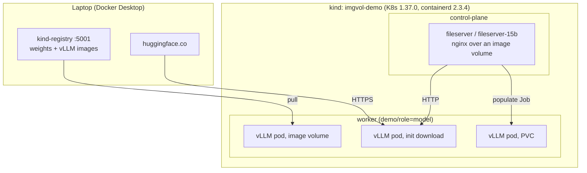

# Image volumes for model weights: OCI images vs downloads vs PVCs, no GPU

[Image volumes](https://kubernetes.io/docs/tasks/configure-pod-container/image-volumes/)
(KEP-4639) are GA in Kubernetes 1.36. This demo ships Qwen2.5-Instruct weights
as a data-only OCI image, mounts them into vLLM, and times that path against a
Hugging Face download, an in-cluster HTTP mirror and a pre-populated PVC.

Post: [Image Volumes Went GA in Kubernetes 1.36 - Should You Ship Your Models as OCI Images?](https://srekubecraft.io/posts/kubernetes-image-volumes-model-weights/)

## Shape



| Piece | Version |
|---|---|
| kind node | `kindest/node:v1.37.0` (pinned by digest) |
| Registry | `registry:3`, the [kind local registry recipe](https://kind.sigs.k8s.io/docs/user/local-registry/) |
| Runtime | `vllm/vllm-openai-cpu:v0.33.0` (arm64 and amd64, pinned by digest) |
| Models | `Qwen/Qwen2.5-0.5B-Instruct` @ `7ae5576`, `Qwen/Qwen2.5-1.5B-Instruct` @ `989aa79` (Apache-2.0) |

## Requirements

- kind v0.33.0+, kubectl, docker, task, curl, jq
- About 25 GB free disk and 16 GB memory for Docker. One 1.5B vLLM pod uses ~12 GiB

## Quick start

```bash
task up                         # cluster, registry, both weights images, mirrors, PVCs
task run M=imagevolume          # one vLLM pod to Ready, prints the phase timeline
task run M=pvc SIZE=1.5b        # M=imagevolume|pvc|lan|hf, SIZE=0.5b|1.5b, ID=run id
task delivery R=1 HF=1          # delivery-only round for both sizes -> results/delivery.tsv
task cold                       # prints the crictl rmi that makes the next round cold
```

`run` leaves the vLLM pod running so you can probe it
(`kubectl -n models apply -f kubernetes/workloads/90-probe.yaml`). Delete it before
the next `run`: two 1.5B pods do not fit in 24 GiB.

`task cold` prints the eviction command instead of running it.

## Layout

| Path | What it is |
|---|---|
| `images/weights/Dockerfile` | `FROM scratch`, weights under `/models` |
| `kubernetes/workloads/05-fileserver.yaml` | nginx mirror serving the weights image over HTTP |
| `kubernetes/workloads/10-init-download.yaml` | vLLM with a `curl` init container into an `emptyDir` |
| `kubernetes/workloads/20-pvc.yaml`, `21-pvc-pod.yaml` | PVC, populate Job, vLLM on the PVC |
| `kubernetes/workloads/30-image-volume.yaml` | vLLM with the weights as an image volume |
| `kubernetes/workloads/40-delivery.yaml` | Delivery-only pod template used by `delivery.sh` |
| `kubernetes/workloads/90-probe.yaml` | Service + one completion request Job |
| `scripts/timeline.sh` | Pod conditions, `Pulled` events and vLLM timings for one pod |
| `scripts/run.sh` | Renders a manifest for a method and size, waits for Ready, prints the timeline |
| `scripts/delivery.sh` | One round of delivery-only measurements |

The manifests are written for 0.5B. `run.sh` and `delivery.sh` rewrite the
image refs, Hub revision, mirror and PVC names for 1.5B.

## Results on an Apple Silicon laptop

Delivery only, median of three rounds (two for the Hub):

| Method | 0.5B (1 GB) | 1.5B (3 GB) |
|---|---|---|
| Image volume, warm | 0s | 0s |
| Pre-populated PVC | 0s | 0s |
| In-cluster HTTP download | 2.2s | 4.7s |
| Image volume, cold | 5.5s | 17.8s |
| Hugging Face Hub download | 85.3s | 258.6s |

## Traps hit while building it

| Trap | Fix |
|---|---|
| Image volume mounts the image root, vLLM finds no `config.json` | `subPath: models` (K8s 1.33+, containerd 2.2+) |
| vLLM needs 160 MiB of `/dev/shm`, pods get 64 MiB | `emptyDir` with `medium: Memory` |
| vLLM CPU v0.32.0 returns 500 on the first request | v0.33.0 ([vllm#61992](https://github.com/vllm-project/vllm/pull/61992)) |
| 1.5B `OOMKilled` at 8Gi | 12Gi limit |
| `curl` against the Hub saves the redirect page | `curl -L` |
| Service names cannot contain dots | Object names use `15b`, image refs keep `1.5b` |
| kind never garbage-collects images (`imageGCHighThresholdPercent: 100`) | `crictl rmi` between rounds, watch the Docker disk |

## Teardown

```bash
kind delete cluster --name imgvol-demo
docker rm -f kind-registry
```
