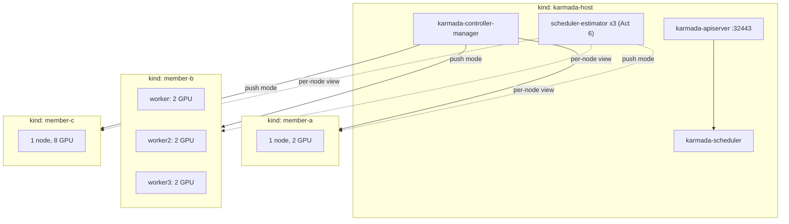

# Karmada v1.19 multi-component scheduling: one training job, three clusters, no GPU

[Karmada](https://karmada.io) graduated from the CNCF in September 2026, alongside
v1.19.0. That release advances `MultiplePodTemplatesScheduling`: Karmada reads the
master and worker templates of a `PyTorchJob` separately, places the whole job in one
member cluster, and records the per-component result on the `ResourceBinding`
(`spec.clusters[*].components`).

This demo runs that path end to end on a laptop and shows the four conditions it
needs. Each one fails silently or with a misleading message when it is missing.

## What makes it GPU-free

| Primitive | What it does here |
|---|---|
| `nvidia.com/gpu` on `node.status.capacity` | Patched onto member nodes. Karmada's cluster status controller sums every allocatable key, and kube-scheduler on each member enforces it per node |
| `registry.k8s.io/pause` | The `pytorch` container. Nothing trains, the demo is about placement |
| Kubeflow training-operator v1.9.4 | Real `kubeflow.org/v1` `PyTorchJob` controller on each member, so pods are created and scheduled for real |

## Shape



Two jobs, both with a CPU master and two GPU workers:

| Job | Per worker | Total GPU | Fits in |
|---|---|---|---|
| `train-small` | 1 GPU | 2 | a, b, c |
| `train-big` | 3 GPU | 6 | c only. b has six GPUs in total but two per node |

## Versions

| Component | Version |
|---|---|
| Karmada / karmadactl | v1.19.0 (checksum verified on download) |
| kind | v0.33.0, node image `v1.37.0` pinned by digest |
| Kubeflow training-operator | v1.9.4 (`kubeflow.org/v1`, the API Karmada ships an interpreter for) |

## Run it

Needs `kind`, `kubectl`, `docker`, `jq`, `curl`, `task`. About 7 kind nodes, roughly
6 GB of Docker memory. `karmadactl` is downloaded into `./bin`, Karmada certs and
kubeconfigs land in `./.karmada`, both gitignored.

```bash
task up              # 4 clusters, fake GPUs, karmadactl init, join, training-operator
```

The acts are ordered: each one changes the control plane for the ones after it.

| # | Command | What you see |
|---|---|---|
| 1 | `task copies` | Gate off. `Divided` + `Aggregated` policy. The binding has no replicas and no components, and **one full copy of the job runs in every member** |
| 2 | `task gate:on && task copies:gated` | Gate on. `spec.components` now lists `master,worker`, and **the job still runs three times**. The multi-component path only applies with a cluster spread constraint of exactly `minGroups: 1, maxGroups: 1` |
| 3 | `task one` | Spread constraint added. `Scheduled=False: no enough resource when selecting 1 clusters`, with 16 free GPUs across the fleet |
| 4 | `task modeling:off && task one` | `CustomizedClusterResourceModeling=false` on the scheduler. The job lands whole in one member with the per-component result recorded |
| 5 | `task fragment` | `train-big` is sent to member-b. Karmada reports `Scheduled` and `FullyApplied`, both workers stay `Pending` forever with `Insufficient nvidia.com/gpu` |
| 6 | `task estimator && task fragment` | Accurate scheduler-estimators see nodes, not cluster totals. `train-big` lands on member-c and runs |

`task status` prints the binding, the scheduling condition and the pods per member at
any time. `task reset` clears jobs and policies.

## What it shows

1. **Gate off, a `PyTorchJob` is a non-workload.** The built-in interpreter for
   `kubeflow.org/v1/PyTorchJob` defines `componentResource` but no `replicaResource`.
   With the gate off the detector falls back to `GetReplicas`
   (`pkg/detector/detector.go:1513`), finds nothing, and the scheduler treats the job
   like a ConfigMap: every candidate cluster gets a copy, whatever the policy says.
2. **Gate on is not enough.** The multi-component estimator path is behind
   `isMultiTemplateSchedulingApplicable` (`pkg/scheduler/core/estimation.go:43`), which
   requires a `spreadByField: cluster` constraint with `minGroups: 1` and
   `maxGroups: 1`. Without it, multi-component workloads "propagate to all candidate
   clusters" (`pkg/scheduler/core/common.go:72`).
3. **The default resource models have no GPU.** `CustomizedClusterResourceModeling`
   is beta and on by default. Each member's `spec.resourceModels` only grades `cpu` and
   `memory`, and the general estimator simulates the job against those model nodes
   (`pkg/estimator/client/general.go:241`). Any component that requests
   `nvidia.com/gpu` fits zero times. A CPU-only copy of the same job schedules fine.
   Adding the accurate estimator does not help: the scheduler keeps the minimum across
   estimators.
4. **The general estimator sums.** Without models it divides cluster totals by the
   per-set request (`pkg/estimator/client/general.go:163-201`), so six GPUs on three
   nodes look like room for two three-GPU workers. The binding reports success, the
   pods never start, and v1.19 does not reschedule multi-template workloads.

## Setup gotchas

- `karmadactl init` advertises the host node IP (`172.18.0.x`), which macOS cannot
  route to, and fails creating its first namespace. `--karmada-apiserver-advertise-address 127.0.0.1`
  fixes it, `127.0.0.1` is always in the cert SANs. A failed init is not idempotent:
  delete the host cluster and `.karmada/` before retrying.
- `karmadactl join` records the kubeconfig server as the cluster `apiEndpoint`
  (`pkg/karmadactl/join/join.go:263`), which is `127.0.0.1:<port>` for kind. The
  `join` task patches it to `https://<member>-control-plane:6443` on the kind network.
  `addons enable karmada-scheduler-estimator` has the same problem with its secret.
- The control plane deployments from `init` use required pod anti-affinity with
  `maxUnavailable: 0`, so any rolling update deadlocks on a one-node host. The `gates`
  task switches them to `Recreate`.
- `init` starts the scheduler with `--enable-scheduler-estimator=true` and no
  estimators, so it logs dial timeouts until Act 6.

## Teardown

Run it yourself:

```bash
task down
```
